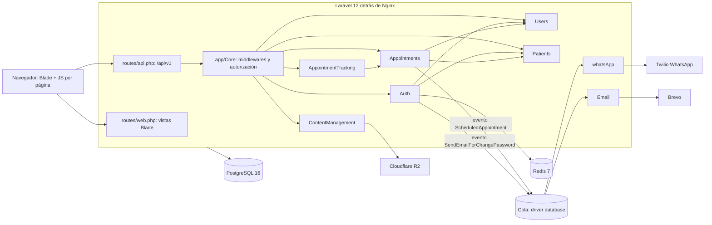

# Arquitectura de Dentissa

## Resumen
Dentissa es un **monolito modular** en Laravel 12 (PHP 8.4). Cada dominio de negocio vive en
`app/Modules/<Módulo>` con capas hexagonales: `Domain` (entidades, value objects, interfaces de
repositorio, servicios, eventos), `Aplication`/`Application` (DTOs, casos de uso) e
`Infrastructure` (controladores invocables, FormRequests, API Resources, Eloquent, migraciones,
listeners, clientes externos). `app/Core` es el kernel compartido (autorización, middlewares,
`UuidIdentifier`). El frontend son vistas Blade servidas por `routes/web.php` con un archivo JS
vanilla por página que consume `/api/v1` con `fetch`. Se eligió así para aislar dominios sin el
coste operativo de microservicios (ver [ADR 0002](adr/0002-monolito-modular-laravel.md)).

## Diagrama de componentes

Texto alternativo: el navegador llama a las vistas web y a la API `/api/v1`; la API pasa por los
middlewares de `app/Core` hacia los módulos. Appointments y Auth emiten eventos que se procesan en
cola por los módulos whatsApp (Twilio) y Email (Brevo). ContentManagement guarda imágenes en R2.
Auth guarda tokens de reset en Redis. Todos persisten en PostgreSQL.

## Módulos
| Módulo | Ruta | Responsabilidad | Depende de |
|---|---|---|---|
| Core | `app/Core` | `CurrentActorAuthorizationService::assertCan` (mapa `permiso → roles`), `can()` (la misma comprobación sin lanzar) y `currentActorId()` (id del staff que actúa, para los permisos `*-own`), middlewares `OnlyAdmin`, `EnsureActiveStaff` (alias `staff`) e `InjectSanctumTokenFromCookie`, `UnexpectedErrorResponse`, `UuidIdentifier`, `TrimsPasswordFields` | Users (modelo y roles) |
| Auth | `app/Modules/Auth` | Login unificado staff/paciente, registro público de pacientes, logout, reset de contraseña | Users, Patients, Core |
| Users | `app/Modules/Users` | CRUD del personal (Administrador, Asistente, Doctor) y roles | Core |
| Patients | `app/Modules/Patients` | Pacientes, contacto, dirección, datos médicos y expediente consolidado | Core |
| Appointments | `app/Modules/Appointments` | Citas, disponibilidad sin solapamiento, catálogo de tratamientos, catálogos de agenda | Patients, Users, Core |
| AppointmentTracking | `app/Modules/AppointmentTracking` | Completar cita con seguimiento clínico y recetas | Appointments, Core |
| ContentManagement | `app/Modules/ContentManagement` | Landing y CRUD de certificaciones, galería, promociones y testimonios (submódulos en `Modules/`) | Core |
| Email | `app/Modules/Email` | Correo transaccional de reset vía Brevo (listener en cola) | Auth (evento) |
| whatsApp | `app/Modules/whatsApp` | Confirmación de cita por plantilla Twilio (listener en cola) | Appointments (evento) |
| Reports | `app/Modules/Reports` | Reporte mensual de la clínica (spec 019): indicadores agregados en pantalla y en Excel, de solo lectura ([ADR 0006](adr/0006-modulo-reports-de-solo-lectura.md)) | Appointments, Patients, Users (solo lectura y solo en `Infrastructure/`), Core |

## Flujo principal
Crear una cita:
1. `resources/js/pages/agenda/create-appointment.js` hace `POST /api/v1/appointments` con `credentials: 'include'`.
2. Middlewares: `throttle:api` → `InjectSanctumTokenFromCookie` (cookie `auth_token` → `Authorization: Bearer`) → `auth:sanctum`.
3. `CreateAppointmentController` (sin FormRequest) construye `CreateAppointmentDTO` y llama a `RetriveDataForScheduledAppointmenEventUseCase`.
4. `CreateAppointmentUseCase` crea los value objects, verifica disponibilidad con `ScheduleAvailabilityChecker` y persiste vía `AppointmentsService` → `AppointmentsRepositoryInterface` → `EloquentAppointmentRepository`.
5. Se lee el paciente y su contacto, se dispara `ScheduledAppointment` y se responde 201.
6. `CreatedAppointmentListener` (`ShouldQueue`, 3 intentos, 15 s de espera) envía la plantilla de Twilio.

## Datos
- Motor: PostgreSQL 16 (`config/database.php` por defecto `pgsql`; `.env.example` trae `sqlite`, ver deuda).
- ORM: Eloquent, con modelos dentro de cada módulo (`Infrastructure/Persistence/Eloquent/Models`); `app/Models` está vacío.
- Migraciones: por módulo en `Infrastructure/Persistence/Eloquent/Migrations`, cargadas con `loadMigrationsFrom` en `AppServiceProvider::boot`; `database/migrations` solo tiene tablas técnicas (cache, jobs, tokens).
- Entidades: Role, User (uuid), Patient (uuid), ContactInfo, Address, MedicalData (1:1 con paciente), Treatment, Appointment (uuid, estados `asignada`/`reprogramada`/`completada`/`cancelada`), AppointmentTracking (1:1 con cita), Prescription, Certification, GalleryImage (`galery_images`), Promotion, Testimonial.
- Seeder: `RoleSeeder` fija los roles 1/2/3.

## Integraciones externas
- **Twilio** (`twilio/sdk` 8.11.6): WhatsApp saliente, `app/Modules/whatsApp/Infrastructure/ExternalApi/TwilioConection.php`.
- **Brevo** (`getbrevo/brevo-php` 4.0.16): correo de reset, `app/Modules/Email/Infrastructure/ExternalApi/BrevoApi.php`.
- **Cloudflare R2** vía disco `s3` (`league/flysystem-aws-s3-v3`): imágenes de contenido, `app/Modules/ContentManagement/StorageProvider.php`.
- **Redis** (Predis): tokens de reset de contraseña con TTL de 15 min.
- No hay webhooks entrantes.

## Frontend
- Componentes y organización: `resources/views/layouts/{admin,app,dashboard,landing,patient,error}`, componentes Blade en `components/{ui,calendar,landing,records}` y páginas en `pages/<sección>/index.blade.php` con sus diálogos al lado. Los componentes `x-ui.*` (botón, campo, marca, diálogo, región de estado, contador, filtro, insignia, registro, subtítulo, encabezado de página) son la única forma de pintar esos elementos (spec 016).
- JS: un archivo por página en `resources/js/pages/<sección>/<acción>.js`, cada uno declarado a mano como entrada en `vite.config.js`; `fetch` a `/api/v1`. Lo común vive en `resources/js/ui/`: `dialog.js` abre y cierra los `<dialog>` y devuelve el foco, `status.js` anuncia avisos y errores en la región de estado con textos propios en español, y `badge.js` pinta las insignias de estado.
- Estado: sin librería de estado; cada página mantiene su estado en el DOM.
- Routing: rutas web en español (`/agenda`, `/pacientes`, `/expedientes-clinicos`, `/contenido`) definidas como closures en `routes/web.php`. Cualquier otra dirección web cae en una ruta de respaldo declarada en `bootstrap/app.php`, fuera del grupo `web`, que responde la página "No encontrada" sin abrir sesión.
- Design tokens / sistema de diseño: Tailwind 4 CSS-first. `resources/css/app.css` declara en `@theme` los únicos colores, radios y tamaños de control, con la paleta por defecto de Tailwind desactivada; sin modo oscuro. El sistema está en [design/system.md](design/system.md) (2.0.0) y lo hacen cumplir `tests/Modules/Core/Unit/Design` y `npm run test:ui` (`tests/Browser/`), que revisa cada pantalla y diálogo a 390, 768 y 1440 px.
- Diseño adaptable: el menú lateral del panel y el menú del sitio público se despliegan desde 1024 px; por debajo se usa el menú plegable.
- Accesibilidad: objetivo **WCAG 2.1 AA**. La spec 016 revisó todas las pantallas: contraste de texto 4.5:1, controles de 44 px, un foco visible, etiquetas y nombres accesibles, diálogos con foco atrapado y todo alcanzable con teclado, comprobado por `npm run test:ui`; la comprobación con lector de pantalla es manual.
- Páginas de error: `resources/views/errors/{403,404,405,419}.blade.php` sobre `layouts/error`, con texto fijo en español y el camino de vuelta.

## Backend
- Contratos de API: no hay OpenAPI. El contrato implícito son los `JsonResource` de cada módulo; forma de respuesta `{"message"}` en escrituras, `{"error"}` en errores y `{"data": [...]}` en lecturas.
- Autenticación y autorización: tokens personales de Sanctum en cookie `auth_token` (httpOnly). Dos capas (spec 014): middleware por tipo de actor (`only.admin`, o `staff` para cualquier staff activo y `staff:<roles>` en la web) y `assertCan` en cada caso de uso, con un mapa `permiso → roles` en `CurrentActorAuthorizationService` como única fuente de verdad (todo el staff lee pacientes y expedientes; administrador y asistente editan datos clínicos y gestionan la agenda; el resto es solo del administrador). Spec 018: los permisos "propios" del doctor (`appointments.view-own`, `appointment-tracking.create-own`, `.view-own`) se comprueban con `can()` y el caso de uso compara el dueño de la cita con `currentActorId()`; con `appointments.view-own` el listado se filtra por su id en el repositorio. Detalle y riesgos en [security.md](security.md).
- Manejo de errores (spec 014): los controladores traducen las excepciones de negocio (400, 403, 404, 409, 422) y envían cualquier otra a `UnexpectedErrorResponse` (500 `{"error": "Internal server error"}`, log `unexpected_error` sin el mensaje). `withExceptions` en `bootstrap/app.php` hace de red para `api/*`: 401 siempre en JSON, `AuthorizationException` de Core → 403, lo no capturado → `UnexpectedErrorResponse`, y sin el reporte por defecto de Laravel para esas excepciones.
- Tiempo (spec 017): la zona de toda la aplicación es la de la clínica, `America/Mexico_City`
  (`APP_TIMEZONE`, valor por defecto en `config/app.php`); rige el "ahora" de las citas, las citas de
  hoy y la vigencia de las promociones. El dominio de citas no lee el reloj: `AppointmentEntity::create()`
  y `reschedule()` reciben el "ahora" (`DateTimeImmutable`) del caso de uso y rechazan un momento igual o
  anterior; `reschedule()` y `cancel()` rechazan una cita completada o cancelada, y `complete()` una cancelada.
- Errores de las pantallas web (spec 016): `only.admin` y `staff` responden `abort(403)` sin mensaje fuera de `api/*`. Un render propio en `withExceptions` devuelve para los 403, 404, 405 y 419 de rutas web la vista de `errors/` correspondiente, o un JSON fijo en español (`{"message"}`) cuando se pide JSON; `api/*` conserva sus respuestas.
- Observabilidad: logs de Laravel en el canal `stderr` (nivel `info`), recogidos por Alloy → Loki → Grafana; health check `/up` que también comprueba PostgreSQL y Redis (`App\Core\Health\CheckDependenciesOnHealth`, escuchando `DiagnosingHealth`); sin métricas, correlación ni auditoría. Detalle en [observability.md](observability.md).
- Reportes (spec 019, [ADR 0006](adr/0006-modulo-reports-de-solo-lectura.md)): `Reports` lee con consultas de agregación
  de PostgreSQL sobre los modelos de Appointments, Patients y Users (`EloquentMonthlyReportRepository`)
  y nunca carga filas ni columnas de pacientes; `MonthlyReportService` calcula tasas, diferencias y
  tendencias, y el mismo `MonthlyReport` alimenta el JSON y el Excel. El Excel lo escribe
  `openspout/openspout` 5.12.0 ([ADR 0005](adr/0005-openspout-para-excel.md)) solo con celdas de texto o número
  explícitas, detrás del puerto `MonthlyReportExporterInterface` de Application. La pantalla `/reportes`
  llama a `ReportMonth` sin caso de uso para la lista de meses (excepción de P3 aceptada en el plan).
- Seguridad: rate limiting `throttle:api` (10/min por IP sin autenticar, 100/min por usuario) y `throttle:report-downloads` (10 descargas del reporte por minuto por administrador, spec 019) sobre la IP real del visitante (`App\Core\Middlewares\TrustCloudflareProxies` sustituye a `TrustProxies` y confía solo en los rangos de Cloudflare de `config/security.php`); `App\Core\Middlewares\SecurityHeaders` añade CSP con nonce (`Vite::useCspNonce`), `X-Frame-Options`, `nosniff` y `Referrer-Policy`; CORS limitado a `APP_URL` sin credenciales. Ver [security.md](security.md).

## Contrato entre capas
- Fuente de verdad: los `JsonResource` y las rutas de `routes/api.php`; no hay tipos compartidos con el JS. Desde esta constitución (P4), el contrato de cada endpoint nuevo o modificado se escribe en su spec o plan.
- Versionado: prefijo `/api/v1`; un cambio incompatible pasa a `/api/v2`. Excepción aceptada en la spec 017
  (plan D10): `PUT /api/v1/appointments/{id}` y `POST /api/v1/appointments` pasaron sus rechazos de entrada de
  409 a 422 dentro de `/api/v1`, porque su único cliente es el JS de la agenda, que se despliega a la vez.
- Una petición `PUT /api/v1/appointments/{id}` hace una sola acción (reprogramar con fecha y hora, cambiar el
  estado a `completada` o `cancelada`, o el recordatorio); sus reglas de entrada están en
  `UpdateAppointmentRequest`, que autoriza antes de validar. Los rechazos de entrada son 422 con el formato
  de validación de Laravel (`{"message", "errors"}`), el único que la interfaz muestra tal cual.
- Cómo se regenera: no aplica (no hay generación de tipos).

## Despliegue
Dos composiciones sobre el mismo `docker/Dockerfile` multietapa (ADR 0004):
- **Local** (`docker-compose.yml`): etapa `dev` con el código montado, `queue`, nginx sin TLS en el puerto 8000, vite en `127.0.0.1:5173`, PostgreSQL y Redis solo en `127.0.0.1`, y Loki, Grafana y Alloy.
- **Producción** (`docker-compose.prod.yml`, proyecto `dentissa`, en un clon aparte del droplet): imágenes inmutables `dentissa-app:<tag>` (etapa `prod`) y `dentissa-web:<tag>` (etapa `web`, nginx con TLS), `queue`, PostgreSQL y Redis con `healthcheck`, Loki, Grafana en `127.0.0.1` y Alloy. Los volúmenes de datos se comparten con la pila manual anterior, que queda detenida como vuelta atrás.

Delante del droplet está Cloudflare (proxy, Full strict); nginx y Laravel toman la IP real de
`CF-Connecting-IP` y `X-Forwarded-For` solo desde los rangos de Cloudflare. La operación pasa por
`docker/prod/` (`deploy.sh`, `rollback.sh`, `backup.sh`, `restore.sh`, `verify.sh` y `compose.sh`),
con backups diarios por cron y un registro de operaciones en `deploys.log`. El detalle está en
[deployment.md](deployment.md).

## Evidencia (solo si status=inferred)
| Afirmación | Archivos | Confianza |
|---|---|---|
| Monolito modular con capas hexagonales | `app/Modules/*/{Domain,Aplication,Infrastructure}` | alta |
| Bindings interfaz → Eloquent centralizados | `app/Providers/AppServiceProvider.php` | alta |
| Rutas centralizadas, sin rutas por módulo | `routes/api.php`, `routes/web.php`, `bootstrap/app.php` | alta |
| Migraciones por módulo | `AppServiceProvider::boot` | alta |
| Auth por token Sanctum en cookie | `bootstrap/app.php:23-27`, `app/Core/Middlewares/InjectSanctumTokenFromCookie.php` | alta |
| Efectos laterales por eventos en cola | `app/Providers/EventServiceProvider.php`, `app/Modules/whatsApp/Infrastructure/Listeners/CreatedAppointmentListener.php` | alta |
| Posible doble registro de listeners | `bootstrap/app.php:9-12` + `EventServiceProvider::$listen` | media |
| Frontend con JS por página | `vite.config.js`, `resources/js/pages/*` | alta |

## Deuda técnica y riesgos observados
- Grafía de capas inconsistente: `Aplication` (mayoría) frente a `Application` (AppointmentTracking, raíz de ContentManagement); `Http` frente a `HTTP` (ContentManagement).
- Fugas de capa: `TreatmentsService` importa `EloquentTreatmentRepository`; `LoginService` y `LogoutUseCase` usan modelos Eloquent y facades; varios UseCases de Patients saltan el Domain Service.
- Imports cruzados sobrantes: `SendEmailForChangePasswordEvent` importa `AppointmentEntity`; `SendPasswordResetListener` importa clases de Appointments y whatsApp.
- Posible doble ejecución de listeners (descubrimiento automático + `$listen`); verificar con `php artisan event:list`.
- Validación con FormRequest solo en Auth y Users; el resto valida en value objects.
- 48 controladores devuelven `$e->getMessage()` en respuestas 500.
- No hay scheduler (`schedule:work`) en ninguno de los dos Compose; los backups usan el cron del host. Los listeners `ShouldQueue` sí tienen worker (`queue`, spec 015).
- Los cuatro `Get*Controller` de ContentManagement devuelven un objeto en vez de una lista cuando hay un solo registro; la galería pública falla con una imagen (roadmap, Pendientes y deuda).
- `Modules/` en la raíz está vacío; `DatabaseSeeder` referencia `App\Models\User`, que no existe. (`app/Modules/Estadisticas`, que se citaba aquí, nunca existió en el disco; su lugar lo ocupa `Reports`, spec 019.)
- README y `ARCHITECTURE.md` declaran PHP 8.2 y PHPUnit; el proyecto usa PHP 8.4 y Pest 3.
- Interfaz (tras la spec 016): sigue sin alternativa para quien pide menos movimiento (`DS12` de [design/system.md](design/system.md)); `npm run test:ui` necesita Chrome en el equipo y, en local, los datos de `ui:audit-data`; las fuentes son las del sistema, así que el ancho de los textos cambia entre equipos; y la página 500 de las pantallas web sigue siendo la genérica de Laravel.
